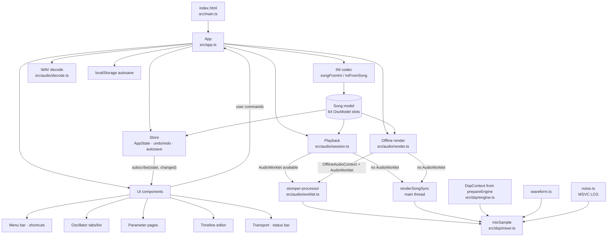
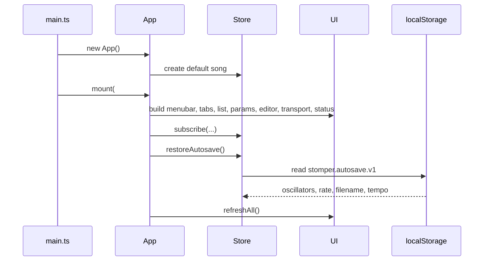
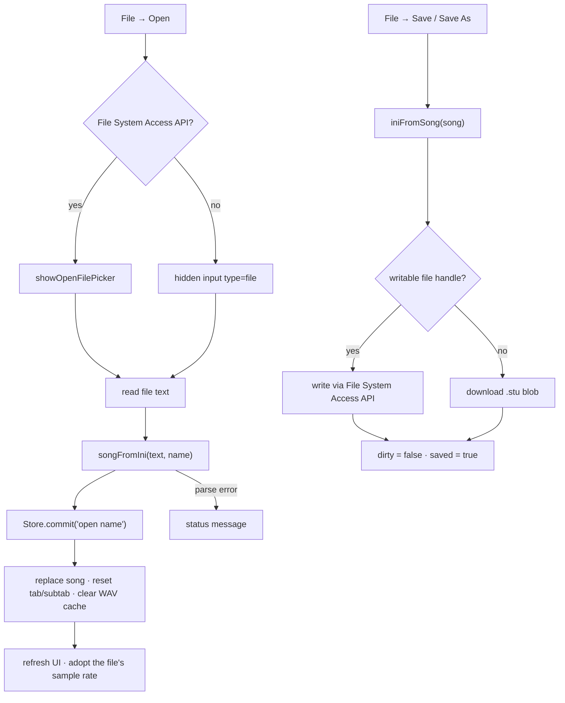
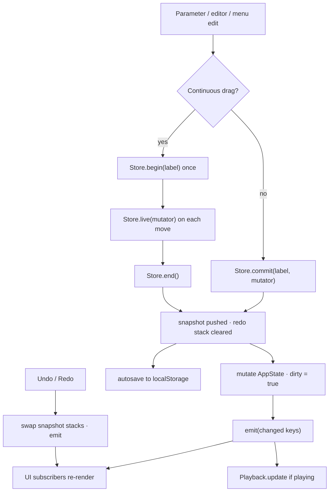
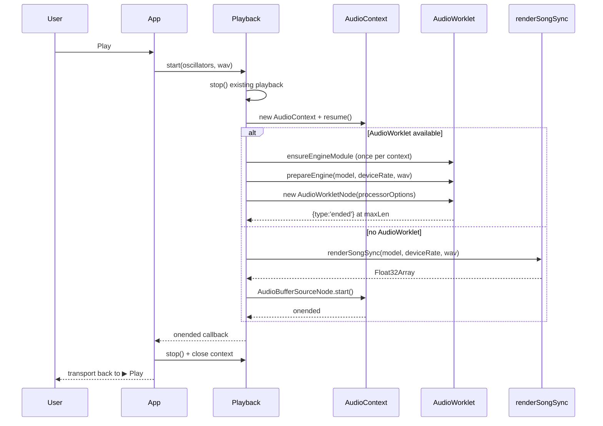
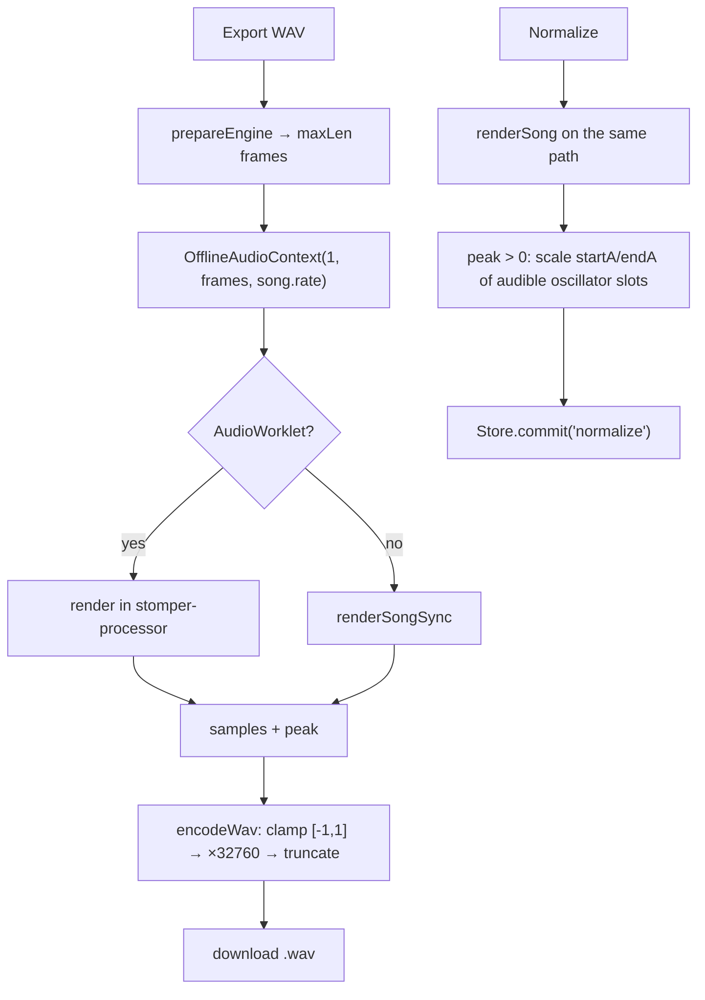
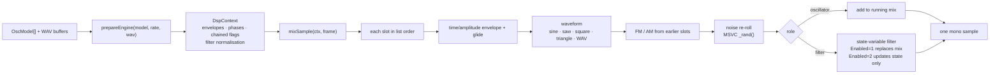

# Application flow

Runtime and user-flow diagrams for the Stomper Hyperion web port. The source
module named in each step is the authoritative implementation.

## Runtime overview

Live playback runs at the device sample rate; offline export runs at the song's
selected rate. Both feed the same `prepareEngine`/`mixSample` engine.

## Startup

If a previous session was restored, the status bar reports it. A clean start
shows the default one-oscillator song at 48000 Hz.

## Open and save

The loader applies the original defaults for missing keys and treats
`Enabled=-1` as On.

## Editing, undo and autosave

Dragging is one undo step: the snapshot is taken at `begin`, and `end` commits
the gesture. The undo stack holds up to 200 snapshots.

## Playback

While a worklet render is running, model edits call `Playback.update`, which
posts a freshly prepared `DspContext` to the processor without restarting it.
Fallback playback uses a fixed buffer, so live edits do not affect it. Pressing
Stop, or reaching the natural end, disconnects the node and closes the context.

## Export and normalize

`Normalize` is a modelled port of `FUN_00406A70`: render, find the peak, then
divide the amplitude envelope of every slot with `enabled === 1` and
`role === 0`.

## DSP sample path

The mixer is sequential and order-dependent, matching `FUN_004083B0`: a filter
processes everything mixed before it.
